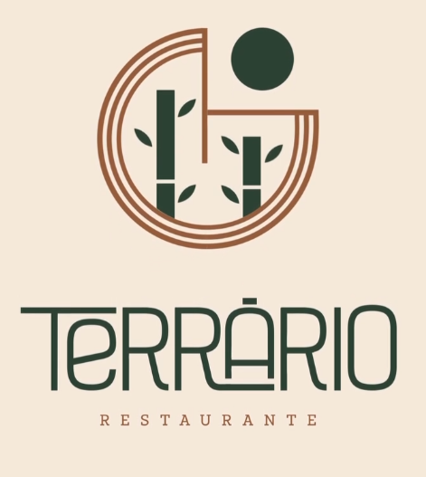

<div align="center">
  

  <h1>Terrário Restaurante</h1>
  <p><strong>Um jardim à mesa, feito para celebrar.</strong></p>
  <p>Experiência digital mobile-first para conhecer o restaurante, explorar o cardápio e solicitar uma reserva pelo WhatsApp.</p>
</div>

<p align="center">
  
  
  
  
  
</p>

---

## Sobre o projeto

O Terrário é um restaurante de alta gastronomia pensado para encontros, celebrações e momentos em família. Este projeto reúne a presença digital do restaurante em uma interface responsiva, com prioridade para o uso em celulares: em poucos toques, a pessoa pode conhecer os ambientes, consultar pratos e bebidas e enviar uma solicitação de reserva.

O site é uma vitrine e um canal de contato — **não recebe pedidos de delivery nem confirma reservas automaticamente**. A solicitação é preparada no aplicativo ou site do WhatsApp e a confirmação fica a cargo da equipe do restaurante.

## O que você encontra

- **Início:** apresentação do Terrário, comodidades, pratos em destaque, ambientes, avaliações, endereço e horários.
- **Cardápio:** categorias e filtros para o menu Kids, itens sem carne e sem glúten. Toque em um prato para consultar seus detalhes.
- **O espaço:** galeria de ambientes, informações sobre a Área Kids e acessibilidade, além de contato para solicitar uma proposta para o salão privativo.
- **Reservas:** fluxo em etapas para escolher data, turno e horário, ocasião, ambiente, necessidades especiais e dados de contato. Ao concluir, abre o WhatsApp com uma mensagem formatada.
- **Navegação mobile:** navegação inferior, áreas de toque confortáveis, botões de reserva acessíveis durante a navegação e respeito à preferência por movimento reduzido.
- **Identidade visual:** fotografia, paleta em tons de floresta, areia e terracota, e tipografia editorial.

## Tecnologias

| Tecnologia | Uso |
| --- | --- |
| React 18 e TypeScript | Interface e componentes |
| Vite | Servidor de desenvolvimento e build de produção |
| React Router | Navegação entre páginas |
| Tailwind CSS e PostCSS | Estilos e layout responsivo |
| Framer Motion | Transições e interações |
| Radix UI Dialog | Base acessível para o painel de detalhes dos pratos |
| Lucide React | Ícones |

O conteúdo do cardápio, dos ambientes e das informações do restaurante está organizado em módulos TypeScript. As imagens e o manifesto ficam em `public/`.

## Pré-requisitos

- **Node.js 20.19 ou superior** ou **22.12 ou superior**.
- **npm**, incluído na instalação do Node.js.

> A versão mínima do Node.js acompanha os requisitos do Vite usado pelo projeto.

## Instalação e execução

No terminal, acesse a pasta do projeto e instale as dependências:

```bash
npm ci
```

Inicie o servidor local:

```bash
npm run dev
```

O Vite informa no terminal o endereço local — normalmente `http://localhost:5173`. Como o servidor é iniciado com suporte a acesso pela rede (`--host`), também é possível abrir o endereço de rede exibido no terminal em outro dispositivo conectado à mesma rede.

Para encerrar o servidor, use `Ctrl+C`.

## Comandos npm

| Comando | Descrição |
| --- | --- |
| `npm ci` | Instala as dependências a partir do `package-lock.json`. Recomendado para uma instalação reproduzível. |
| `npm install` | Instala dependências e atualiza o lockfile quando necessário. |
| `npm run dev` | Inicia o servidor de desenvolvimento do Vite. |
| `npm run build` | Gera a versão otimizada para produção na pasta `dist/`. |
| `npm run preview` | Serve localmente o build já gerado para conferência. Execute `npm run build` antes. |
| `npm run typecheck` | Verifica os tipos TypeScript sem gerar arquivos. |

## Estrutura do projeto

```text
.
├── public/
│   ├── img/                 # Identidade visual, fotos, bandeiras e imagens do menu
│   └── manifest.webmanifest # Metadados e ícone para acesso pela tela inicial
├── src/
│   ├── components/          # Navegação, cards, selos, painel de pratos e UI
│   ├── data/                # Cardápio, informações do restaurante e ambientes
│   ├── lib/                 # Formatação e integração de links do WhatsApp
│   ├── pages/               # Início, Cardápio, O espaço e Reservas
│   ├── App.tsx              # Rotas da aplicação
│   ├── index.css            # Estilos globais e elementos visuais
│   └── main.tsx             # Inicialização do React
├── index.html
├── package.json
└── vite.config.ts
```

### Rotas

| Caminho | Página |
| --- | --- |
| `/` | Início |
| `/cardapio` | Cardápio |
| `/o-restaurante` | O espaço |
| `/reservas` | Solicitação de reserva |

## Dados a configurar antes de publicar

As informações operacionais ficam em [`src/data/info.ts`](src/data/info.ts). Antes de disponibilizar o site, substitua os valores de exemplo pelo contato e endereço reais do restaurante e confira os horários:

- `whatsapp`: número com código do país e DDD, somente dígitos, no formato usado por `wa.me` (por exemplo, `55` + DDD + número).
- `address`: endereço completo que será exibido no rodapé da página inicial.
- `hours`: dias e horários de atendimento exibidos no rodapé.
- `OPEN_SHIFTS`: turnos (Almoço/Jantar) em que o formulário aceita reservas em cada dia da semana (0 = domingo … 6 = sábado). Mantenha coerente com `hours`; segunda-feira está como fechada.
- `TIMES`: horários oferecidos em cada turno.

Os depoimentos ficam em `REVIEWS` ([`src/data/spaces.ts`](src/data/spaces.ts)). A seção "Quem já esteve aqui" só aparece quando houver depoimentos **reais** cadastrados.

Também vale revisar os itens, preços, descrições e imagens em [`src/data/menu.ts`](src/data/menu.ts), assim como os ambientes, selos e avaliações em [`src/data/spaces.ts`](src/data/spaces.ts).

## Build e publicação

Gere os arquivos de produção:

```bash
npm run build
```

O conteúdo pronto para publicação será criado em `dist/`. Para conferir esse build localmente:

```bash
npm run preview
```

O projeto é uma aplicação frontend servida como arquivos estáticos e não possui backend próprio. Como usa `BrowserRouter`, o servidor precisa devolver `index.html` para qualquer rota (`/cardapio`, `/reservas`…), senão abrir um link direto resulta em 404. Em Netlify e Cloudflare Pages isso já está resolvido pelo arquivo `public/_redirects`; em outras hospedagens configure o fallback equivalente (GitHub Pages não suporta isso de forma nativa).

A solicitação de reserva depende do WhatsApp. O manifesto web está configurado em `public/manifest.webmanifest`; **não há service worker configurado**, portanto o projeto não oferece funcionamento offline por cache.
